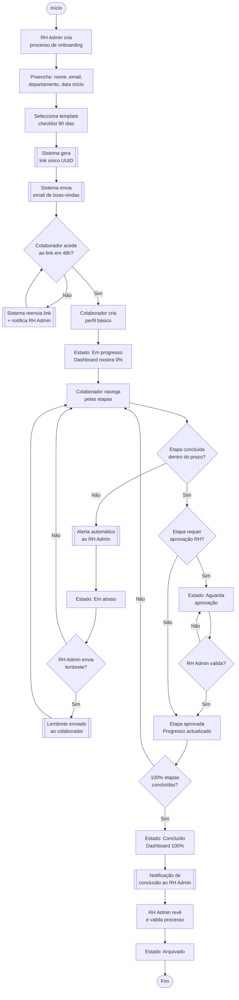
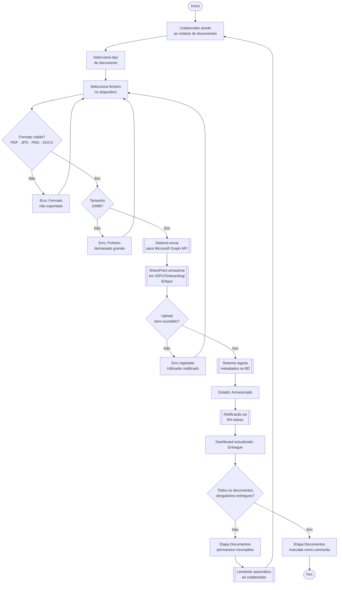
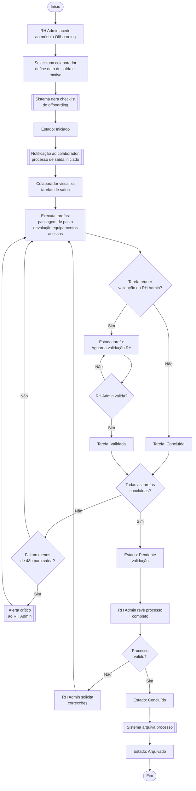
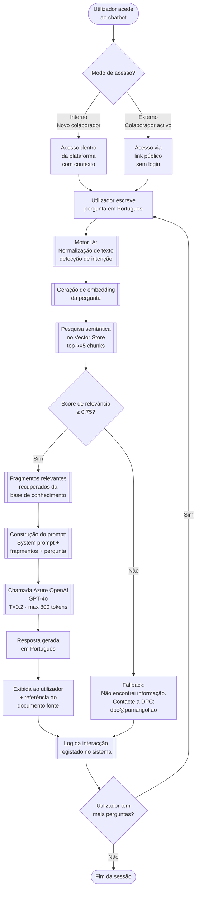
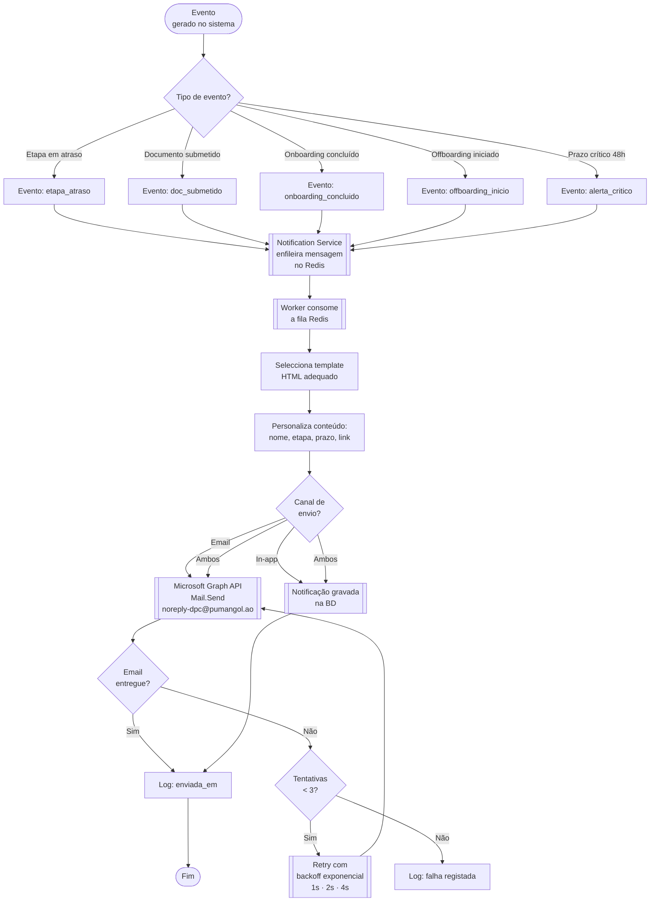
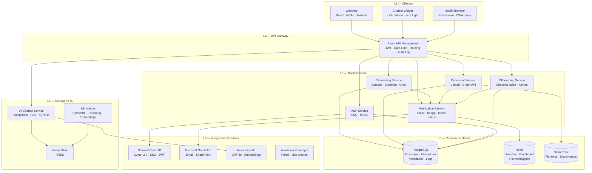
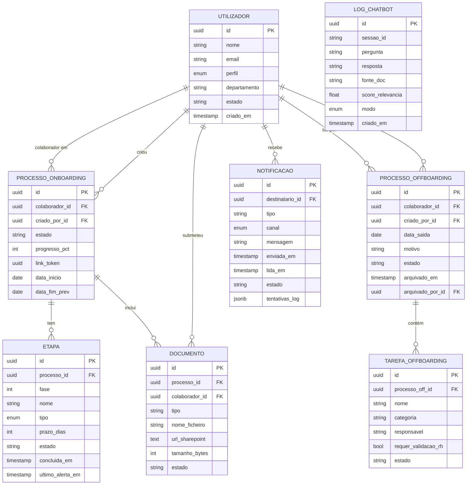
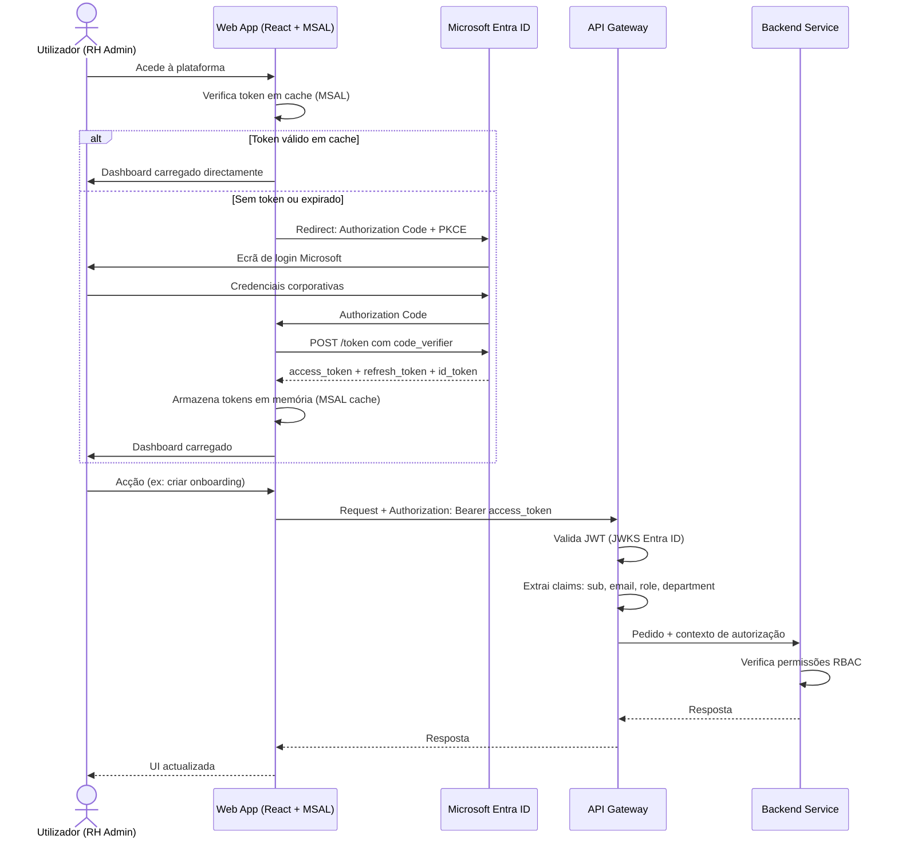

# Diagramas Mermaid — Plataforma DPC Pumangol
## Fluxos Funcionais e Diagramas de Arquitectura
### Versão 1.0 · Abril 2025

> Fonte original: `ADT_Arquitectura_APIs_Modelos_Pumangol_v1.0.pdf` e `Diagramas_Mermaid_Pumangol_v1.0.md`

---

## FL-01 · Fluxo de Onboarding de Novo Colaborador

---

## FL-02 · Fluxo de Submissão e Gestão de Documentos

---

## FL-03 · Fluxo de Offboarding de Colaborador

---

## FL-04 · Fluxo do Assistente IA — Arquitectura RAG

---

## FL-05 · Motor de Notificações (Assíncrono)

---

## ARQ-01 · Arquitectura de Alto Nível — Camadas do Sistema

---

## ARQ-02 · Modelo de Entidades

---

## ARQ-03 · Fluxo de Autenticação SSO (Microsoft Entra ID)

